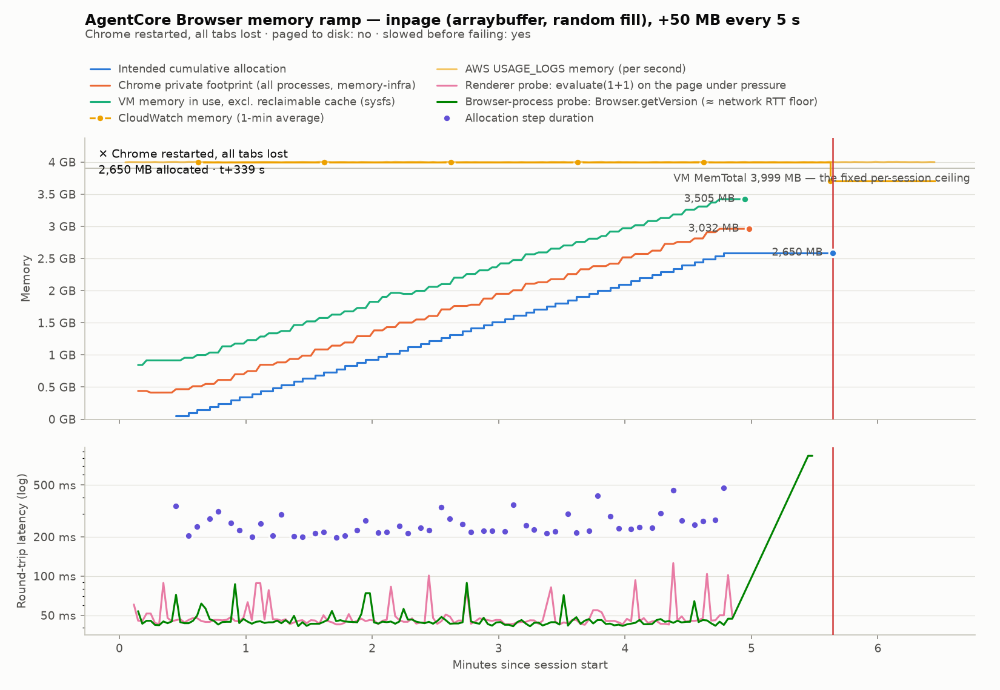
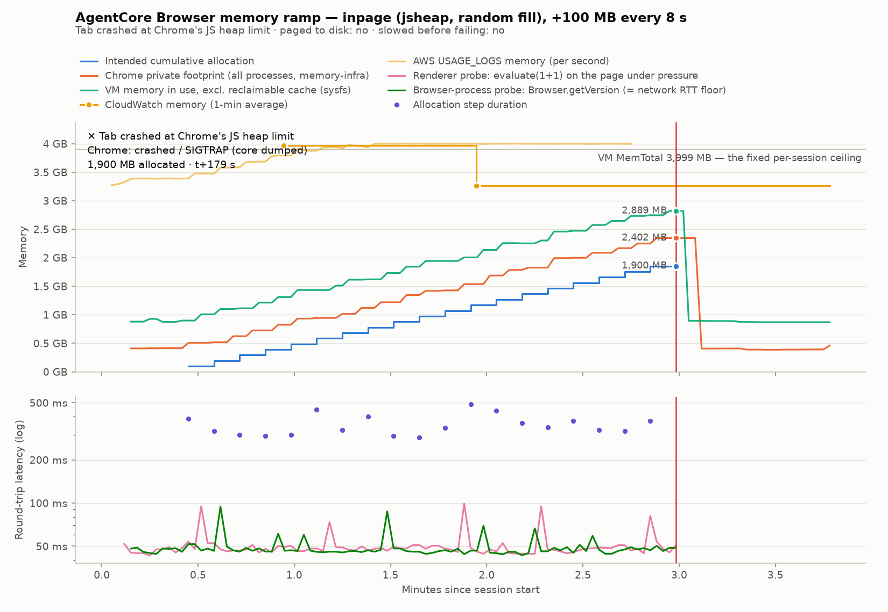
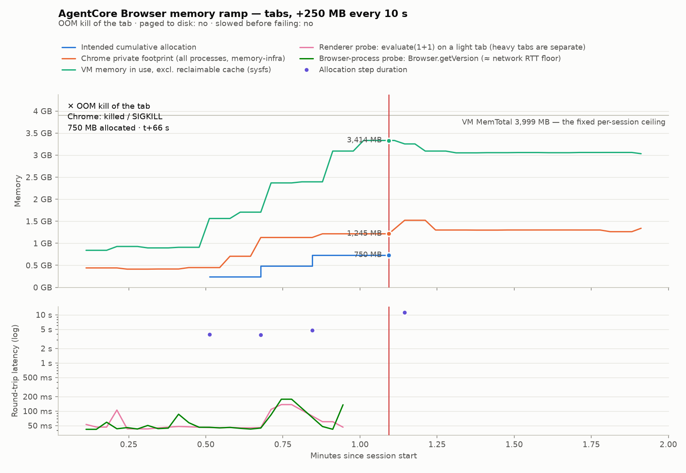

# AgentCore Browser 4 GB memory ceiling — findings

_Auto-generated by `benchmark.py` after every run (per-run reports live in `runs/<run-id>/`)._

## The three answers

_From all 10 runs that reached the limit._

**1. Does it page to disk?** No. `SwapCached` peaked at 0 MB across every run, the VM has no zram or zswap (`zswap_enabled=N`, zram devices: none), and disk writes didn't rise. Under pressure Linux evicted up to 77% of its page cache instead. Compressible data failed at the same point as incompressible data (2,600 MB vs 2,600 / 2,650 MB), so there is no hidden compression or de-duplication either.

**2. Does it slow down first?** Not in a way you can use as a warning. Median round-trip latency during the ramp was within 4% of its baseline in every run, and allocation steps got at most 2.2× slower near the limit. Then the final allocation stalled: 9–22 s before a tab was killed, 47–48 s before Chrome restarted. The JavaScript-heap crash came with no stall at all.

**3. What is the failure mode?** One of two outcomes, and the session survived both:

- **The tab dies and everything else keeps running (5 runs).** The Linux OOM killer sent the tab's process `SIGKILL` (4 runs), or, for JavaScript-heavy pages, Chrome crashed the tab itself at its JavaScript heap limit, at 1,900 MB (1 run). Chrome kept the same process and connection, and the other tabs stayed open.
- **Chrome restarts and every tab is lost (5 runs).** The whole VM froze for 47–48 s, the CDP connection dropped, and Chrome came back as a new process. The process ID changed in both runs that checked it; the other 3 predate the check but show the same freeze, disconnect and return to idle memory.

In every case `GetBrowserSession` still reported `READY`, and a new tab or connection worked within about a second.

**Cost consequence.** AgentCore's per-second usage telemetry metered memory at a median of 3.5–4.0 GB per session across all 11 sessions with data, and never below 3.2 GB outside the session's final shutdown seconds, including 2 idle sessions in which the browser used only 0.9 GB. It neither tracked what the pages used nor behaved as a strict high-water mark. Memory therefore costs roughly $0.033–$0.038 per session-hour whatever the pages do; the lever on memory cost is **session count × lifetime**. CPU does scale with work, and idle CPU is free.

| run | strategy | failure mode | memory at failure | paged to disk? | slowed first? | memory after failure |
|---|---|---|---:|---|---|---:|
| `20261013T163724Z-inpage` | inpage | No failure up to the configured limit | — (stopped at 300 MB) | not applicable (ceiling not reached) | no | n/a |
| `20261013T164258Z-inpage` | inpage | Connection dropped at the ceiling (restart not checked) | 2,600 MB | no | yes | n/a |
| `20261013T165154Z-inpage` | inpage | Connection dropped at the ceiling (restart not checked) | 2,600 MB | no | yes | n/a |
| `20261013T165611Z-inpage` | inpage | Connection dropped at the ceiling (restart not checked) | 2,600 MB | no | yes | -2,726 MB |
| `20261013T170040Z-tabs` | tabs | No failure up to the configured limit | — (stopped at 500 MB) | not applicable (ceiling not reached) | no | n/a |
| `20261013T170135Z-tabs` | tabs | OOM kill of the tab | 750 MB | no | no | -64 MB |
| `20261014T221150Z-inpage` | inpage | No failure up to the configured limit | — (stopped at 1 MB) | not applicable (ceiling not reached) | no | n/a |
| `20261014T221505Z-inpage` | inpage | No failure up to the configured limit | — (stopped at 1 MB) | not applicable (ceiling not reached) | no | n/a |
| `20261014T221820Z-inpage` | inpage | Chrome restarted, all tabs lost | 2,650 MB | no | yes | -2,723 MB |
| `20261014T222450Z-inpage` | inpage | OOM kill of the tab | 2,600 MB | no | yes | -2,565 MB |
| `20261014T222801Z-inpage` | inpage | Tab crashed at Chrome's JS heap limit | 1,900 MB | no | no | -1,957 MB |
| `20261014T223151Z-tabs` | tabs | OOM kill of the tab | 750 MB | no | no | -273 MB |
| `20261014T223640Z-inpage` | inpage | Chrome restarted, all tabs lost | 2,600 MB | no | yes | -2,718 MB |
| `20261014T224029Z-inpage` | inpage | OOM kill of the tab | 2,600 MB | no | yes | -2,576 MB |

**Reproducibility**

- `inpage` (arraybuffer, random fill), 200 MB steps: 4 runs reached the limit with differing failure modes (Chrome restarted, all tabs lost, Connection dropped at the ceiling (restart not checked)) at 2,600 MB every time.
- `tabs`, 250 MB steps: 2 runs reached the limit with the same failure mode (OOM kill of the tab) at 750 MB every time.
- `inpage` (arraybuffer, touch fill), 200 MB steps: 2 runs reached the limit with the same failure mode (OOM kill of the tab) at 2,600 MB every time.

**Billed memory vs actual consumption** (from AWS's per-second `USAGE_LOGS`). Runs that allocated almost nothing were billed the same as runs that reached the ceiling:

| run | allocated | observed peak (VM in use) | billed memory (median) | share of seconds at full 4 GB | records |
|---|---:|---:|---:|---:|---:|
| `20261013T163724Z-inpage` | 300 MB | 1.20 GB | 4.00 GB | 98% | 43 |
| `20261013T164258Z-inpage` | 2,600 MB | 3.22 GB | 4.00 GB | 83% | 255 |
| `20261013T165154Z-inpage` | 2,600 MB | 3.40 GB | 4.00 GB | 100% | 239 |
| `20261013T165611Z-inpage` | 2,600 MB | 3.42 GB | 4.00 GB | 99% | 226 |
| `20261013T170040Z-tabs` | 500 MB | 2.47 GB | 4.00 GB | 95% | 43 |
| `20261013T170135Z-tabs` | 750 MB | 3.27 GB | 4.00 GB | 98% | 119 |
| `20261014T221150Z-inpage` | 1 MB | 0.95 GB | 4.00 GB | 100% | 192 |
| `20261014T221505Z-inpage` | 1 MB | 0.93 GB | 3.52 GB | 29% | 192 |
| `20261014T221820Z-inpage` | 2,650 MB | 3.42 GB | 4.00 GB | 100% | 387 |
| `20261014T222450Z-inpage` | 2,600 MB | 3.44 GB | 4.00 GB | 81% | 134 |
| `20261014T222801Z-inpage` | 1,900 MB | 2.82 GB | 4.00 GB | 68% | 165 |

## Example: Chrome restart

_Auto-generated by `benchmark.py` from `runs/20261014T221820Z-inpage/` (session `01M4Y7XGHVF7GV96DPXHW5TSG5`, us-west-2, `aws.browser.v1`). Regenerate with `python benchmark.py --reanalyze runs/20261014T221820Z-inpage`._

### Answers

1. **Did it page to disk?** **No — there is nowhere to page to.** The microVM has no swap device, no zram and zswap disabled, so when anonymous memory grows the kernel can only evict page cache and then kill. Evidence: zswap enabled: `N`, zram devices: none, block devices: ['loop0', 'loop1', 'loop2', 'loop3', 'loop4', 'loop5', 'loop6', 'loop7', 'vda', 'vdb']; `SwapCached` peak 0 MB; VM free memory bottomed at 88 MB (2.2% of RAM) and stayed there; the kernel reclaimed page cache instead — `FilePages` fell 76% under pressure; anonymous memory reached 83% of RAM; disk writes p50 0.1 MB/s at baseline vs 0.1 MB/s across the ramp (max 0.6 MB/s) — no write surge. The last successful step left 2,650 MB retained, 87% of the ~3,063 MB the VM could still hand out before the ramp (free + reclaimable cache; MemTotal 3,999 MB).

2. **Did it slow down before failing?** **Barely, and then all at once.** Throughput stayed flat almost to the end; this is a cliff, not the long GC-thrash ramp you might expect. Renderer round-trip (`evaluate(1+1)` on the page under pressure): 46 ms at baseline → median 46 ms across the ramp (p95 85 ms, max 126 ms), and 49 ms over the last 5 samples before failure. Browser-process probe (`Browser.getVersion`, whose baseline is essentially the runner's network RTT): 45 ms → 45 ms. Allocation step time: 277 ms (first 5 steps) → 270 ms (last 3 that completed), and the step that killed the renderer ran 47 s before dying. The cliff: the final step ran 47 s before the renderer died, vs 0.3 s for early steps (171×). (The fixed 30 s pre-failure window is empty: once the final allocation stalled, the probe loop deliberately skips rather than queueing behind it, so the figures above come from the last samples taken before the stall.)

3. **What was the failure mode, and at what memory reading?** **The VM stalled, the CDP connection dropped and Chrome came back as a new process with every tab lost** — `page_closed` at t+339 s (2026-10-14T22:24:01.177Z), with **2,650 MB** of retained allocations. Chrome reported no exit code because the automation connection itself dropped (the observable symptom was `page_closed`). At that point the guest VM was out of memory: free 88 MB (2.2% of RAM), page cache down 76%, swap unused, and the final allocation had been stuck for 47 s. Last readings before the failure: VM free 90 MB, VM available (est.) 494 MB, VM in use excl. cache 3,505 MB, Chrome private footprint 3,032 MB (largest renderer 2,633 MB), CDP heap+ArrayBuffers 2,651 MB, CloudWatch 3,796 MB. **The session itself survived**: reconnecting to the same CDP endpoint worked immediately afterwards, so the microVM was not torn down. CDP connection dropped: yes; GetBrowserSession status after the failure: `READY`. Chrome's browser process after recovery was **a different one** (PID 751 → 3181), so Chrome itself was restarted and every tab was lost. The page that held the memory: gone: no target with its title remains. Pages still open afterwards: `New Tab`.

### After the ceiling: plateau, drop, or climb?

| signal | last before failure | after the kill (reconnect) | change |
|---|---:|---:|---:|
| VM in use excl. cache | 3,505 MB | 782 MB | -2,723 MB |
| VM free | 90 MB | 2,524 MB | 2,434 MB |
| Chrome private footprint | 3,032 MB | n/a | n/a |

Memory **dropped** right after the failure — the killed process's memory went back to the VM. That is the signature of a kill at a hard cap, not of paging (paging would keep memory pinned near the ceiling while allocations continued and latency climbed).

### Billing implication

AgentCore Browser is priced per second at $0.00945/GB-hour of memory and $0.0895/vCPU-hour of CPU, documented as *peak memory consumed up to that second* with a 128 MB floor. This session ran 387 s.

**Measured, from AWS's own per-second `USAGE_LOGS` for this session** (387 records): metered memory was **4.00 GB at the median** (p25 4.00 GB, max 4.01 GB) and at the VM's full RAM size for 100% of the session's seconds — about **1.7×** the memory the session actually had in use (mean 2.39 GB, excluding reclaimable cache).

> **This contradicts the intuition that staying well under the ceiling is cheaper.** Billed memory did not track what the browser actually used (which over this run ranged from 0.91 GB at idle baseline to a peak of 3.42 GB) — it was the session's entire 4 GB allocation for virtually every second the session existed. Memory therefore costs a flat **$0.0378/session-hour** whether the agent idles on `about:blank` or rides the ceiling. The lever on memory cost is **session count × session lifetime**, not per-session frugality.

CPU, by contrast, did vary with work: 0.05–1.00 vCPU (median 0.21), consistent with the documented "I/O wait and idle time is free" behaviour. A fully busy vCPU adds $0.0895/hour.

| memory signal | peak | mean | est. memory cost of this run |
|---|---:|---:|---:|
| chrome_pmf | 2.96 GB | 1.92 GB | $0.0020 |
| vm_in_use_excl_cache | 3.42 GB | 2.39 GB | $0.0024 |
| vm_used_incl_cache | 3.82 GB | 3.57 GB | $0.0036 |
| aws_usage_logs | 4.01 GB | 4.00 GB | $0.0041 |

CPU (Chrome processes, summed from CDP `SystemInfo.getProcessInfo`): 65.5 vCPU-s over 319.7 s of sampled time ≈ $0.0016. Sampling stops when the connection drops, so this covers only the sampled window, not necessarily the whole session.
CloudWatch `memory`: 0.51982 gb-hours ≈ $0.0049.
CloudWatch `cpu`: 0.040142 vcpu-hours ≈ $0.0036.

Observed consumption peaked at 4.01 GB (`aws_usage_logs`), which at list price is **$0.0379/hour in memory**. At the full 4 GB that is $0.0378/hour — which is what was actually billed here, so this figure is the floor as well as the ceiling for a live session.

### Signals used

- CloudWatch memory: `AWS/Bedrock-AgentCore:MemoryUsed-GBHours[Resource=aws.browser.v1,Service=AgentCore.Browser]` (scope **resource**, Sum, converted from gb_hours).
- CloudWatch cpu: `AWS/Bedrock-AgentCore:CPUUsed-vCPUHours[Resource=aws.browser.v1,Service=AgentCore.Browser]` (scope **resource**, Sum, converted from vcpu_hours).
- CloudWatch sessions: `AWS/Bedrock-AgentCore:ActiveSessionCount[Service=AgentCore.Browser]` (scope **service**, Maximum, converted from count).
- CloudWatch memory datapoints inside the session window: 7 (peak 4,096 MB; covers whole session: True).
- USAGE_LOGS (per-second session usage): 387 record(s) from ['/aws/vendedlogs/bedrock-agentcore/browser/USAGE_LOGS/aws.browser.v1'], peak 4,102 MB.
- CDP: `Runtime.getHeapUsage` (V8 heap + ArrayBuffer backing store), `Performance.getMetrics`, `SystemInfo.getProcessInfo` (per-process CPU), memory-infra dumps (43) for per-process private footprint, `Target.targetCrashed` / `page.on('crash')` / WebSocket `disconnected` for failure detection.
- Guest VM: `/sys/devices/system/node/node0/meminfo` and `/sys/block/*/stat` read through a `file://` tab (52 samples). Capabilities: `{"meminfo_readable": true, "block_devices": ["loop0", "loop1", "loop2", "loop3", "loop4", "loop5", "loop6", "loop7", "vda", "vdb"], "zram_devices": [], "blk_vda_size_gb": 1.66, "blk_vda_readonly": true, "blk_vdb_size_gb": 16.0, "blk_vdb_readonly": false, "zswap_enabled": "N", "ksm_run": "0", "thp_enabled": "always [madvise] never", "kernel_swap_support": true, "mem_total_mb": 3999.4}`.

### Run

- Parameters: `{"step_mb": 50, "interval_s": 5.0, "max_mb": 4600, "alloc_kind": "arraybuffer", "fill": "random", "sample_interval_s": 2.0, "memdump_interval_s": 6.0, "host_interval_s": 5.0}`
- Browser: Chrome 148.0.7778.258, hardwareConcurrency=1 (the documented 1 vCPU), V8 jsHeapSizeLimit=2,222 MB, VM MemTotal=3,999 MB (the documented 4 GB).
- Events:

  - t+338.6 s `page_closed` {"page": "alloc", "role": "strategy"}
  - t+338.6 s `page_closed` {"page": "host", "role": "observer"}
  - t+338.6 s `cdp_disconnected` {"in_flight_target_mb": 2700}
  - t+358.6 s `browser_probe_timeout` {"timeout_s": 30.0}
  - t+384.9 s `recovery_ok` {"via": "reconnect", "ms": 988, "browser_pid_before": 751, "browser_pid_after": 3181, "same_browser_process": false, "surviving_pages": ["New Tab"], "pressured_page": "gone: no target with its title remains"}
  - t+386.4 s `page_closed` {"page": "host", "role": "observer"}

Artifacts: `timeseries.csv` (table view of the chart), `chart.png`, `samples.jsonl` (raw), `cloudwatch.json`, `discovery.json`, `benchmark.log`.

## Example: tab killed (single page)

_Auto-generated by `benchmark.py` from `runs/20261014T222801Z-inpage/` (session `01M4Y8F7K8VBHH2GYXWZN56YN4`, us-west-2, `aws.browser.v1`). Regenerate with `python benchmark.py --reanalyze runs/20261014T222801Z-inpage`._

### Answers

1. **Did it page to disk?** **No — there is nowhere to page to.** The microVM has no swap device, no zram and zswap disabled, so when anonymous memory grows the kernel can only evict page cache and then kill. Evidence: zswap enabled: `N`, zram devices: none, block devices: ['loop0', 'loop1', 'loop2', 'loop3', 'loop4', 'loop5', 'loop6', 'loop7', 'vda', 'vdb']; `SwapCached` peak 0 MB; VM free memory bottomed at 89 MB (2.2% of RAM) and stayed there; the kernel reclaimed page cache instead — `FilePages` fell 44% under pressure; anonymous memory reached 68% of RAM; disk writes p50 0.1 MB/s at baseline vs 0.1 MB/s across the ramp (max 0.6 MB/s) — no write surge. The last successful step left 1,900 MB retained, 62% of the ~3,088 MB the VM could still hand out before the ramp (free + reclaimable cache; MemTotal 3,999 MB).

2. **Did it slow down before failing?** **No — it stayed flat until the cliff.** Renderer round-trip (`evaluate(1+1)` on the page under pressure): 48 ms at baseline → median 48 ms across the ramp (p95 79 ms, max 99 ms), and 51 ms over the last 5 samples before failure. Browser-process probe (`Browser.getVersion`, whose baseline is essentially the runner's network RTT): 48 ms → 48 ms. Allocation step time: 298 ms (first 5 steps) → 323 ms (last 3 that completed), and the step that killed the renderer ran 1 s before dying.

3. **What was the failure mode, and at what memory reading?** **The tab crashed at Chrome's own JavaScript heap limit (V8 out of memory)** — `page_crash` at t+179 s (2026-10-14T22:31:02.260Z), with **1,900 MB** of retained allocations (step to 2,000 MB in flight). Chrome reported the target `crashed` with exit status `SIGTRAP (core dumped)`. Processes that disappeared at the failure: pid 1027 (renderer, last 2,013 MB). Last readings before the failure: VM free 92 MB, VM available (est.) 1,110 MB, VM in use excl. cache 2,889 MB, Chrome private footprint 2,402 MB (largest renderer 2,013 MB), CDP heap+ArrayBuffers 1,977 MB, CloudWatch 3,345 MB. **The session itself survived**: a new tab worked immediately afterwards, so the microVM was not torn down, and only the tab's process died. CDP connection dropped: no; GetBrowserSession status after the failure: `READY`. Chrome's browser process after recovery was **the same one** (PID 751 → 751), so Chrome itself was not restarted. The page that held the memory: dead: its target remains but its renderer no longer answers. Pages still open afterwards: `New Tab`, `bench-alloc`, `stat`.

### After the ceiling: plateau, drop, or climb?

| signal | last before failure | after the kill (reconnect) | change |
|---|---:|---:|---:|
| VM in use excl. cache | 2,889 MB | 932 MB | -1,957 MB |
| VM free | 92 MB | 2,072 MB | 1,981 MB |
| Chrome private footprint | 2,402 MB | 401 MB | -2,002 MB |

Memory **dropped** right after the failure — the killed process's memory went back to the VM. That is the signature of a kill at a hard cap, not of paging (paging would keep memory pinned near the ceiling while allocations continued and latency climbed).

### Billing implication

AgentCore Browser is priced per second at $0.00945/GB-hour of memory and $0.0895/vCPU-hour of CPU, documented as *peak memory consumed up to that second* with a 128 MB floor. This session ran 227 s.

**Measured, from AWS's own per-second `USAGE_LOGS` for this session** (165 records): metered memory was **4.00 GB at the median** (p25 3.59 GB, max 4.00 GB) and at the VM's full RAM size for 68% of the session's seconds — about **2.5×** the memory the session actually had in use (mean 1.59 GB, excluding reclaimable cache).

> **Billed memory did not track use.** It stayed around 4.0 GB, roughly 3× what was actually in use, for the whole session. Trimming memory inside a session would not have reduced it.

CPU, by contrast, did vary with work: 0.05–1.00 vCPU (median 0.16), consistent with the documented "I/O wait and idle time is free" behaviour. A fully busy vCPU adds $0.0895/hour.

| memory signal | peak | mean | est. memory cost of this run |
|---|---:|---:|---:|
| chrome_pmf | 2.35 GB | 1.13 GB | $0.0009 |
| vm_in_use_excl_cache | 2.82 GB | 1.59 GB | $0.0012 |
| vm_used_incl_cache | 3.82 GB | 3.10 GB | $0.0021 |
| aws_usage_logs | 4.00 GB | 3.86 GB | $0.0023 |

CPU (Chrome processes, summed from CDP `SystemInfo.getProcessInfo`): 29.0 vCPU-s over 218.6 s of sampled time ≈ $0.0007. Sampling stops when the connection drops, so this covers only the sampled window, not necessarily the whole session.
CloudWatch `memory`: 0.175019 gb-hours ≈ $0.0017.
CloudWatch `cpu`: 0.009765 vcpu-hours ≈ $0.0009.

Holding a session at 4.00 GB (`aws_usage_logs`), which at list price is **$0.0378/hour in memory** versus $0.0083/hour at the idle baseline (0.88 GB) — **4.5×**. At the full 4 GB that is $0.0378/hour; a fully busy vCPU adds a further $0.0895/hour, but idle and I/O-wait CPU is free, so memory dominates the bill of a mostly idle session and scales with how close to the ceiling it rides.

### Signals used

- CloudWatch memory: `AWS/Bedrock-AgentCore:MemoryUsed-GBHours[Resource=aws.browser.v1,Service=AgentCore.Browser]` (scope **resource**, Sum, converted from gb_hours).
- CloudWatch cpu: `AWS/Bedrock-AgentCore:CPUUsed-vCPUHours[Resource=aws.browser.v1,Service=AgentCore.Browser]` (scope **resource**, Sum, converted from vcpu_hours).
- CloudWatch sessions: `AWS/Bedrock-AgentCore:ActiveSessionCount[Service=AgentCore.Browser]` (scope **service**, Maximum, converted from count).
- CloudWatch memory datapoints inside the session window: 3 (peak 4,060 MB; covers whole session: True).
- USAGE_LOGS (per-second session usage): 165 record(s) from ['/aws/vendedlogs/bedrock-agentcore/browser/USAGE_LOGS/aws.browser.v1'], peak 4,100 MB.
- CDP: `Runtime.getHeapUsage` (V8 heap + ArrayBuffer backing store), `Performance.getMetrics`, `SystemInfo.getProcessInfo` (per-process CPU), memory-infra dumps (33) for per-process private footprint, `Target.targetCrashed` / `page.on('crash')` / WebSocket `disconnected` for failure detection.
- Guest VM: `/sys/devices/system/node/node0/meminfo` and `/sys/block/*/stat` read through a `file://` tab (38 samples). Capabilities: `{"meminfo_readable": true, "block_devices": ["loop0", "loop1", "loop2", "loop3", "loop4", "loop5", "loop6", "loop7", "vda", "vdb"], "zram_devices": [], "blk_vda_size_gb": 1.66, "blk_vda_readonly": true, "blk_vdb_size_gb": 16.0, "blk_vdb_readonly": false, "zswap_enabled": "N", "ksm_run": "0", "thp_enabled": "always [madvise] never", "kernel_swap_support": true, "mem_total_mb": 3999.4}`.

### Run

- Parameters: `{"step_mb": 100, "interval_s": 8.0, "max_mb": 4600, "alloc_kind": "jsheap", "fill": "random", "sample_interval_s": 2.0, "memdump_interval_s": 6.0, "host_interval_s": 5.0}`
- Browser: Chrome 148.0.7778.258, hardwareConcurrency=1 (the documented 1 vCPU), V8 jsHeapSizeLimit=2,222 MB, VM MemTotal=3,999 MB (the documented 4 GB).
- Events:

  - t+179.0 s `page_crash` {"page": "alloc", "role": "strategy", "source": "page.on(crash)", "crashes": 1, "in_flight_target_mb": 2000}
  - t+179.0 s `target_crashed` {"page": "alloc", "status": "crashed", "error_code": 133, "exit_status": "SIGTRAP (core dumped)", "target_id": "6F62FA04E63ABD621E5CDACD8C0E6B54"}
  - t+181.3 s `process_vanished` {"pid": 1027, "process_type": "renderer", "last_known_pmf_mb": 2012.6, "was_largest_renderer": true}
  - t+224.9 s `recovery_ok` {"via": "new_page", "ms": 545, "browser_pid_before": 751, "browser_pid_after": 751, "same_browser_process": true, "surviving_pages": ["New Tab", "bench-alloc", "stat"], "pressured_page": "dead: its target remains but its renderer no longer 

Artifacts: `timeseries.csv` (table view of the chart), `chart.png`, `samples.jsonl` (raw), `cloudwatch.json`, `discovery.json`, `benchmark.log`.

## Example: tab killed (several tabs)

_Auto-generated by `benchmark.py` from `runs/20261014T223151Z-tabs/` (session `01M4Y8P8CRQXAZZ0R911PSRBWS`, us-west-2, `aws.browser.v1`). Regenerate with `python benchmark.py --reanalyze runs/20261014T223151Z-tabs`._

### Answers

1. **Did it page to disk?** **No — there is nowhere to page to.** The microVM has no swap device, no zram and zswap disabled, so when anonymous memory grows the kernel can only evict page cache and then kill. Evidence: zswap enabled: `N`, zram devices: none, block devices: ['loop0', 'loop1', 'loop2', 'loop3', 'loop4', 'loop5', 'loop6', 'loop7', 'vda', 'vdb']; `SwapCached` peak 0 MB; VM free memory bottomed at 96 MB (2.4% of RAM) and stayed there; the kernel reclaimed page cache instead — `FilePages` fell -0% under pressure; anonymous memory reached 46% of RAM; disk writes p50 0.1 MB/s at baseline vs 0.1 MB/s across the ramp (max 1.0 MB/s) — no write surge. The last successful step left 750 MB retained, 24% of the ~3,075 MB the VM could still hand out before the ramp (free + reclaimable cache; MemTotal 3,999 MB).

2. **Did it slow down before failing?** **No — it stayed flat until the cliff.** Renderer round-trip (`evaluate(1+1)` on a dedicated light tab, separate from the heavy tabs): 47 ms at baseline → median 46 ms across the ramp (p95 127 ms, max 136 ms), and 60 ms over the last 5 samples before failure. Browser-process probe (`Browser.getVersion`, whose baseline is essentially the runner's network RTT): 44 ms → 84 ms. Allocation step time: 3,936 ms (first 5 steps) → 3,936 ms (last 3 that completed).

3. **What was the failure mode, and at what memory reading?** **OOM kill: the tab's process was SIGKILLed while the VM was out of memory** — `page_crash` at t+66 s (2026-10-14T22:32:59.091Z), with **750 MB** of retained allocations (step to 1,000 MB in flight). Chrome reported the target `killed` with exit status `SIGKILL`. Processes that disappeared at the failure: pid 1412 (renderer, last 310 MB). Last readings before the failure: VM free 96 MB, VM available (est.) 586 MB, VM in use excl. cache 3,414 MB, Chrome private footprint 1,245 MB (largest renderer 311 MB), CDP heap+ArrayBuffers 4 MB, CloudWatch n/a. **The session itself survived**: a new tab worked immediately afterwards, so the microVM was not torn down, and only the tab's process died. CDP connection dropped: no; GetBrowserSession status after the failure: `READY`. Chrome's browser process after recovery was **the same one** (PID 751 → 751), so Chrome itself was not restarted. Pages still open afterwards: `New Tab`, `bench-heavy-1`, `bench-heavy-2`, `bench-heavy-3`, `bench-heavy-4`, `bench-probe`, `stat`.

### After the ceiling: plateau, drop, or climb?

| signal | last before failure | after the kill (reconnect) | change |
|---|---:|---:|---:|
| VM in use excl. cache | 3,414 MB | 3,141 MB | -273 MB |
| VM free | 96 MB | 371 MB | 275 MB |
| Chrome private footprint | 1,245 MB | 1,333 MB | 89 MB |

Memory **dropped** right after the failure — the killed process's memory went back to the VM. That is the signature of a kill at a hard cap, not of paging (paging would keep memory pinned near the ceiling while allocations continued and latency climbed). Note: 1 allocation step(s) that were already in flight completed after the failure, so the post-failure figures include memory they added.

### Billing implication

AgentCore Browser is priced per second at $0.00945/GB-hour of memory and $0.0895/vCPU-hour of CPU, documented as *peak memory consumed up to that second* with a 128 MB floor. This session ran 115 s.

| memory signal | peak | mean | est. memory cost of this run |
|---|---:|---:|---:|
| chrome_pmf | 1.52 GB | 0.99 GB | $0.0003 |
| vm_in_use_excl_cache | 3.33 GB | 2.28 GB | $0.0007 |
| vm_used_incl_cache | 3.81 GB | 3.36 GB | $0.0010 |

CPU (Chrome processes, summed from CDP `SystemInfo.getProcessInfo`): 27.9 vCPU-s over 107.6 s of sampled time ≈ $0.0007. Sampling stops when the connection drops, so this covers only the sampled window, not necessarily the whole session.

Holding a session at 3.33 GB (`vm_in_use_excl_cache`), which at list price is **$0.0315/hour in memory** versus $0.0085/hour at the idle baseline (0.90 GB) — **3.7×**. At the full 4 GB that is $0.0378/hour; a fully busy vCPU adds a further $0.0895/hour, but idle and I/O-wait CPU is free, so memory dominates the bill of a mostly idle session and scales with how close to the ceiling it rides.

### Signals used

- CloudWatch memory: `AWS/Bedrock-AgentCore:MemoryUsed-GBHours[Resource=aws.browser.v1,Service=AgentCore.Browser]` (scope **resource**, Sum, converted from gb_hours).
- CloudWatch cpu: `AWS/Bedrock-AgentCore:CPUUsed-vCPUHours[Resource=aws.browser.v1,Service=AgentCore.Browser]` (scope **resource**, Sum, converted from vcpu_hours).
- CloudWatch sessions: `AWS/Bedrock-AgentCore:ActiveSessionCount[Service=AgentCore.Browser]` (scope **service**, Maximum, converted from count).
- CloudWatch memory datapoints inside the session window: 0 (peak n/a; covers whole session: False).
- USAGE_LOGS (per-second session usage): 0 record(s) from ['/aws/vendedlogs/bedrock-agentcore/browser/USAGE_LOGS/aws.browser.v1'].
- CDP: `Runtime.getHeapUsage` (V8 heap + ArrayBuffer backing store), `Performance.getMetrics`, `SystemInfo.getProcessInfo` (per-process CPU), memory-infra dumps (15) for per-process private footprint, `Target.targetCrashed` / `page.on('crash')` / WebSocket `disconnected` for failure detection.
- Guest VM: `/sys/devices/system/node/node0/meminfo` and `/sys/block/*/stat` read through a `file://` tab (19 samples). Capabilities: `{"meminfo_readable": true, "block_devices": ["loop0", "loop1", "loop2", "loop3", "loop4", "loop5", "loop6", "loop7", "vda", "vdb"], "zram_devices": [], "blk_vda_size_gb": 1.66, "blk_vda_readonly": true, "blk_vdb_size_gb": 16.0, "blk_vdb_readonly": false, "zswap_enabled": "N", "ksm_run": "0", "thp_enabled": "always [madvise] never", "kernel_swap_support": true, "mem_total_mb": 3999.4}`.

### Run

- Parameters: `{"step_mb": 250, "interval_s": 10.0, "max_mb": 3000, "alloc_kind": "arraybuffer", "fill": "random", "sample_interval_s": 2.0, "memdump_interval_s": 6.0, "host_interval_s": 5.0}`
- Browser: Chrome 148.0.7778.258, hardwareConcurrency=1 (the documented 1 vCPU), V8 jsHeapSizeLimit=2,222 MB, VM MemTotal=3,999 MB (the documented 4 GB).
- Events:

  - t+65.6 s `page_crash` {"page": "tab3", "role": "strategy", "source": "page.on(crash)", "crashes": 1, "in_flight_target_mb": 1000}
  - t+65.6 s `target_crashed` {"page": "tab3", "status": "killed", "error_code": 9, "exit_status": "SIGKILL", "target_id": "79F438D21ACC2B1AC690D7CFC089560D"}
  - t+69.4 s `process_vanished` {"pid": 1412, "process_type": "renderer", "last_known_pmf_mb": 310.3, "was_largest_renderer": true}
  - t+112.9 s `recovery_ok` {"via": "new_page", "ms": 677, "browser_pid_before": 751, "browser_pid_after": 751, "same_browser_process": true, "surviving_pages": ["New Tab", "bench-heavy-1", "bench-heavy-2", "bench-heavy-3", "bench-heavy-4", "bench-probe", "stat"]}

Artifacts: `timeseries.csv` (table view of the chart), `chart.png`, `samples.jsonl` (raw), `cloudwatch.json`, `discovery.json`, `benchmark.log`.
